# Catatan progres dan tujuan komponen — 2 Oktober 2026

## Ringkasan eksekutif

Fondasi lab, ground truth awal, dan discovery ZAP telah tersedia. MVP untuk
parser, batch kandidat, validation loop lokal, serta pipeline PDF-RAG sudah
ditulis. Notebook Colab sekarang menguraikan setup LangChain, indexing Chroma,
generasi batch berpasangan, dan runner tunnel bertoken.

Status perlu dibaca dalam tiga tingkat:

1. **Terverifikasi di lab lokal:** DVWA, baseline ground truth, discovery ZAP
   terautentikasi yang diperbaiki, dan satu smoke run validation S1.
2. **Tersedia sebagai kode/notebook, tetapi belum diuji pada runtime:** builder
   PDF-RAG lokal dan keseluruhan pipeline LangChain di Colab.
3. **Belum dilakukan:** eksperimen formal, review semua keputusan manusia,
   perbandingan SecLists lengkap, dan perhitungan FPR/PSR.

## Ruang lingkup penelitian

- **Metode:** DAST black-box terhadap aplikasi yang berjalan; proses validasi
  tidak membaca kode sumber DVWA.
- **Target:** DVWA pada level Low, Medium, High, dan Impossible.
- **Teknik:** SQL injection error-based, boolean-based blind, dan time-based
  blind.
- **Perbandingan:** FPR untuk kondisi LLM tanpa/dengan RAG dan PSR untuk
  kandidat LLM dibanding SecLists, mengikuti definisi operasional proposal.
- XSS dan SAST bukan bagian dari skenario pengukuran proposal ini.

## Progres per komponen

| Komponen | Yang sudah dibuat/dilakukan | Status sekarang |
| --- | --- | --- |
| Lab DVWA | Docker Compose untuk DVWA/MariaDB; port web diikat ke loopback. | Lingkungan lokal tersedia. |
| Tunnel Colab | Gateway memeriksa `X-Lab-Token`; token berada di `dvwa/.env`; Quick Tunnel memberi URL sementara. | Alur Colab berhasil diverifikasi pada 28 September. Tunnel perlu dinyalakan lagi untuk sesi baru. |
| Ground truth | 12 skenario × 3 replikasi; Low/Medium/High memberi sinyal dan Impossible menjadi kontrol negatif. | Baseline awal sudah dicatat; belum menggantikan batch eksperimen formal. |
| ZAP discovery | Plan menggunakan autentikasi browser, memverifikasi sesi/login/level, dan seed helper High. Run passive discovery untuk empat level berhasil pada 1 Oktober. | Membuktikan alur discovery dan autentikasi. Run ini tidak mengirim payload SQLi dan tidak menghasilkan FPR. |
| Observasi ZAP Desktop | Beberapa screenshot/history ditinjau dan batas atribusinya dicatat. | Observasi alert yang dibagikan bukan pengukuran formal SQLi; rincian dan caveat di `zap-baseline-2026-10-01.md`. |
| Katalog/parser | `experiment_scenarios.json`, parser laporan ZAP, schema temuan ternormalisasi, dan kontrak data. | MVP tersedia; perlu diuji terhadap semua bentuk laporan yang akan dipakai eksperimen. |
| Validation loop lokal | Runner membatasi target ke DVWA loopback, mengatur login/level, mengambil baseline, menguji satu skenario, dan mencatat JSONL. | Satu smoke run manual S1 Low error-based memberi sinyal error; label otomatis masih provisional dan `human_validation=pending`. |
| Provenance kandidat | Normalizer memeriksa batch LLM/RAG dan payload SecLists berdasarkan revision, hash file, baris, dan isi. | Kode tersedia; adapter memerlukan file SecLists versi tetap dan review kecocokan skenario. |
| Pipeline lokal RAG/LLM | Ekstraksi PDF, chunking, embedding Ollama, Chroma, retrieval, generator Qwen, audit prompt. | Kode tersedia; belum dijalankan pada model/korpus penelitian. API lokal saat ini memakai Ollama/Chroma langsung. |
| Pipeline LangChain Colab | Notebook memasang integrasi, menjalankan Ollama, membuat Chroma dari PDF, menghasilkan pasangan RAG-off/on, dan menyediakan runner tunnel. | Belum berjalan sampai LangChain. Sel GPU pertama gagal sebelum tahap instalasi; lihat bagian “Temuan notebook Colab”. |
| Evaluasi | Skema dan log mentah mulai tersedia. | Belum ada data formal seimbang untuk menghitung FPR/PSR. |

## Setup LangChain: apa yang dipasang dan untuk apa

LangChain di sini bertindak sebagai **lapisan orkestrasi Python** yang
menghubungkan model Ollama, embedding, dokumen, dan vector store. LangChain
tidak meng-host model atau menyediakan GPU; Ollama tetap menjalankan model di
runtime Colab.

| Komponen | Peran dalam notebook | Mengapa diperlukan |
| --- | --- | --- |
| `langchain-ollama` | Menyediakan `ChatOllama` dan `OllamaEmbeddings`. | Satu antarmuka LangChain untuk meminta Qwen membuat kandidat dan meminta Ollama mengubah teks menjadi embedding. |
| `langchain-chroma` | Menyediakan integrasi Chroma sebagai vector store. | Menyimpan embedding/chunk dan mengambil konteks yang mirip dengan query skenario. |
| `pypdf` | Membaca teks dari PDF yang diunggah ke folder referensi Drive. | Membentuk korpus RAG dari proposal/artikel tanpa memodifikasi PDF sumber. PDF hasil scan tanpa lapisan teks dapat memerlukan OCR dan belum ditangani notebook ini. |
| Ollama `qwen2.5:7b` | Model generasi kandidat. | Menghasilkan kandidat untuk teknik dan skenario yang dipilih. |
| Ollama `nomic-embed-text` | Model embedding. | Mengubah chunk referensi dan query menjadi vektor dengan model embedding yang sama. |
| Chroma | Penyimpanan vector store berisi chunk dan metadata sumber. | Memungkinkan retrieval berdasarkan kemiripan embedding dan menyertakan ID chunk dalam provenance. |
| Google Drive | Menyimpan PDF salinan, manifest, arsip ZIP Chroma, batch kandidat, audit, dan log. | Artefak penting tetap tersedia setelah runtime Colab sementara dihentikan. |

### Mengapa Chroma berupa ZIP di Drive

Notebook membangun dan membuka Chroma pada disk runtime `/content`. Setelah
index selesai, ia menyimpan snapshot ZIP ke Drive beserta manifest. Pada sesi
baru, arsip dipulihkan ke `/content`. Dengan demikian, database SQLite Chroma
tidak aktif menulis langsung ke mount Drive. Manifest mencatat hash PDF,
fingerprint konfigurasi, identitas model/paket, jumlah halaman/chunk, dan hash
arsip agar index yang sama dapat dikenali dan dipakai ulang.

### Alur yang disiapkan notebook

```mermaid
flowchart LR
  P[PDF salinan di Drive] --> X[Ekstraksi teks dan chunk per halaman]
  X --> E[nomic-embed-text]
  E --> C[Chroma di /content]
  C --> Z[Snapshot ZIP dan manifest di Drive]
  S[Katalog skenario] --> Q[Query retrieval]
  Z --> Q
  Q --> R[Chunk dengan ID dan metadata]
  R --> G[ChatOllama Qwen]
  S --> G
  G --> B[Batch RAG-off dan RAG-on + audit]
  B --> H[Review peneliti]
  H --> T[Runner dengan X-Lab-Token]
  T --> D[DVWA melalui Quick Tunnel]
  D --> L[JSONL tanpa rahasia atau body]
  L --> V[Review manusia; keputusan tetap pending]
```



Untuk kondisi **RAG-off**, prompt tidak menerima chunk dan provenance harus
mencatat `knowledge_base_id: null`, `retrieved_chunk_ids: []`, serta
`retrieval_top_k: null`. Untuk kondisi **RAG-on**, prompt menerima top-k chunk
dan mencatat ID chunk yang sama pada provenance/audit. Kedua kondisi memakai
skenario, model, temperatur, seed, versi prompt, dan `comparison_id` yang sama;
hash prompt akan berbeda karena konteks RAG.

### Runner Colab

Runner membaca batch LLM dari Drive, memvalidasi skenario dan provenance,
membatasi target ke HTTPS `*.trycloudflare.com`, mengirim `X-Lab-Token` pada
request/redirect, memakai cookie jar hanya di memori, lalu memverifikasi login
dan level keamanan pada sesi DVWA tersebut. Runner meminta frasa
`SEND_SELECTED_BATCH_TO_MY_DVWA` sebelum ada request, memulai dengan satu
replikasi, dan membatasi maksimum tiga. Log JSONL tidak menyimpan URL tunnel,
token, password, cookie, atau response body. Payload kandidat sendiri tetap
dicatat sebagai data eksperimen; review manusia tetap wajib.

Runner Colab saat ini menerima batch LLM RAG-off/on. Batch SecLists belum dapat
dijalankan melalui runner Colab ini; SecLists masih dapat disiapkan melalui
normalizer dan runner lokal.

## Temuan notebook Colab saat ini

Notebook `colab_langchain_setup.ipynb` yang terbuka di Colab berhenti pada sel
pemeriksaan GPU dengan:

```text
FileNotFoundError: [Errno 2] No such file or directory: 'nvidia-smi'
```

Sel sebelumnya menjalankan `subprocess.run(["nvidia-smi"])`, lalu mengharapkan
kode keluar non-zero bila GPU tidak tersedia. Jika executable sama sekali tidak
ada—misalnya runtime tidak mengekspos utilitas GPU—Python justru melempar
`FileNotFoundError`. Akibatnya, Run All berhenti sebelum instalasi paket
LangChain; output sel-sel setelahnya belum menunjukkan keberhasilan atau error
lanjutan.

Pemeriksaan GPU pada **salinan notebook lokal proyek** telah diperbaiki agar
mencari executable dahulu dan mencetak pesan informatif jika tidak tersedia.
Salinan yang sudah tersimpan di Google Drive belum otomatis menerima edit ini.
Notebook belum dijalankan ulang setelah perbaikan. Qwen 7B tetap memerlukan
resource runtime yang memadai; GPU direkomendasikan bila tersedia.

## Langkah berikutnya

1. Terapkan versi terbaru pemeriksaan GPU pada notebook Colab, pilih runtime
   GPU bila tersedia, lalu jalankan sel setup sampai smoke check Ollama,
   embedding, dan Chroma berhasil.
2. Unggah salinan PDF proposal/referensi yang disetujui ke
   `MyDrive/TA-SQLi/references/`, jalankan build/reuse Chroma, dan simpan
   manifest. Folder `sources/` repositori tetap read-only.
3. Jalankan smoke retrieval, lalu buat pasangan kandidat S1 RAG-off/on dengan
   parameter yang sama. Review batch dan audit sebelum validasi.
4. Nyalakan DVWA dan tunnel lokal, jalankan notebook smoke tunnel, kemudian
   lakukan satu replikasi S1 dengan runner Colab. Periksa JSONL dan lakukan
   review manusia.
5. Tambahkan dukungan batch SecLists pada jalur Colab bila diperlukan untuk
   menjalankan PSR di runtime yang sama.
6. Tetapkan rencana eksperimen formal: skenario, jumlah pengulangan,
   konfigurasi tetap, review label, lalu hitung FPR dan PSR sesuai proposal.

## Dokumen terkait

- `progress-2026-09-28.md` — hasil fondasi lab, ground truth, dan ZAP.
- `zap-baseline-2026-10-01.md` — run ZAP serta batas interpretasinya.
- `validation-loop.md` — runner lokal dan remote Colab.
- `candidate-sources.md` — batch LLM/SecLists dan provenance.
- `zap-normalized-data-contract.md` — format normalisasi laporan.
- `../dvwa/README.md` — perintah menjalankan DVWA, ZAP, dan tunnel.
